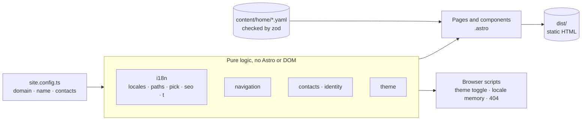

<div align="center">

# Portfolio Website

**The personal website of Yuriy Borovikov, a Flutter mobile developer. A static Astro site in Russian and English, built with strict TypeScript and deployed to GitHub Pages after every check passes.**

[](https://astro.build)
[](https://www.typescriptlang.org)
[](https://tailwindcss.com)
[](https://nodejs.org)
[](#testing)
[](.github/workflows/deploy.yml)

Live · design in progress

<a href="README.ru.md"></a>

</div>

## Live site

<a href="https://yuriyborovikov.com"></a>

## Where the site is now

The site is deployed and the design is in progress. The code for the pages is already in the repo: the locale core, the theme, contacts, navigation and the home page sections. The pages go live once the design is approved.

## What is built

**Two languages.** Russian and English, with English as the default. Every localized route carries a locale prefix (`/en/`, `/ru/`), and pure helpers build paths, read the locale from a path and switch a path to the other language. The language a visitor picks is remembered in `localStorage`; without a saved choice, the first browser language decides (Russian for `ru*`, English otherwise).

**Interface texts and content are separate.** Short interface strings (navigation, buttons, captions) live in typed dictionaries, one per language; a key missing in one of them fails the type check. Longer page copy lives in YAML files in a content collection, and a zod schema checks its shape at build time: three chips at most in the hero, exactly three services.

**Dark and light theme.** Dark by default. A small inline script in `<head>` applies the saved theme before the first paint, so the page does not flash. If storage is blocked, the site stays dark and keeps working.

**Contacts and identity from one config.** The domain, display name per language, Telegram, GitHub and e-mail are set once in `src/site.config.ts`. Links are built from it: a handle with or without `@` gives the same `t.me` link, and an empty value hides the contact.

**SEO.** Pages get a canonical link, `hreflang` alternates for both languages plus `x-default`, and Open Graph tags with the right locale. The site URL in the build comes from the configured domain.

**404 page.** One static page for every unknown address. A script picks its language from the path, the saved choice or the browser, and shows the matching text.

**robots.txt.** Generated at build time; the design concept page is kept out of search.

## Out of scope for now

- **Projects and resume pages.** The navigation already has them behind flags that stay off until the pages exist.
- **Final visual style.** The palette in `global.css` is a working one and will be replaced during the design stage.
- **Animations.** Blocks marked for reveal are prepared in CSS (and stay visible with reduced motion), but no animation is wired up yet.

## Quick start

Requirements: Node.js **22.18+**.

```bash
npm install
npm run dev        # http://localhost:4321
```

| Command | What it does |
|---|---|
| `npm run dev` | Start the dev server |
| `npm run build` | Build the static site into `dist/` |
| `npm run preview` | Serve the built site locally |
| `npm run check` | Type-check with `astro check` |
| `npm test` | Run the unit tests |
| `npm run test:build` | Check the built `dist/` (run `npm run build` first) |
| `npm run verify` | All of the above in order: check, unit tests, build, build checks |

## Architecture



### Key decisions

**Logic does not know about the UI.** Locales, paths, SEO links, contacts, navigation and the theme are plain TypeScript functions with no Astro or DOM imports. Pages and components only compose them, and browser scripts live in `src/scripts/`. This is what makes every piece of logic testable with Node's own test runner, without a browser.

**Nothing is hard-coded in markup.** Visitor-facing strings come from the dictionaries or the content files, contacts and the domain from the config, locales, routes and colors from named constants and theme tokens. Changing a contact or adding a text is an edit in one place.

**Safe storage.** `localStorage` can be missing or throw (private mode, blocked site data). All reads and writes go through two wrappers that return `null` or `false` instead of throwing, so the language and theme memory never breaks a page.

**Small files.** A source file stays under 200 lines; when it grows, it is split by responsibility. The largest file in `src/` is well under that limit.

## Deploy

Work happens on the `dev` branch. A push to `main` runs [deploy.yml](.github/workflows/deploy.yml): the job runs `npm run verify`, and only if every step passes, the built site goes to GitHub Pages. A failing type check, test or build check stops the deploy.

[gitleaks.yml](.github/workflows/gitleaks.yml) scans the full history for secrets on every push to `main` and `dev` and on pull requests.

## Testing

```bash
npm run verify
```

**40 unit tests** on `node:test`, one file per logic module:

- locale paths: adding and stripping the prefix, switching a path to the other language;
- language choice: saved value first, then the browser language;
- `hreflang` links for both languages and `x-default`;
- contact links: handles with and without `@`, empty values hidden;
- display name per language;
- navigation items with the projects and resume pages on and off;
- theme resolution and safe storage when storage throws;
- dictionaries: both languages have the same keys;
- a clear error when a language has no home content file.

**4 checks of the built `dist/`:**

- no empty `href` in any HTML or XML file;
- the root page is the under-construction page: no link to the concept and no redirect;
- the localized pages are not built while the site is under construction;
- `404.html` and `robots.txt` exist, and robots keeps the concept out of search.

## Tech stack

| Area | Technologies |
|---|---|
| Site | Astro 7 (static output, i18n routing, content collections, `astro:assets`) |
| Language | TypeScript, `astro/tsconfigs/strict` |
| Styles | Tailwind CSS 4 via `@tailwindcss/vite`, CSS variables for the theme |
| Content | YAML, zod schemas |
| Quality | `astro check`, `node:test` |
| CI and hosting | GitHub Actions, GitHub Pages, gitleaks |

## Project structure

```
.
├── src/
│   ├── pages/              # root page, 404, robots.txt
│   ├── layouts/            # base layout
│   ├── components/         # head, SEO, header, footer, theme and language switches
│   │   └── home/           # hero, about, technologies, services, contacts
│   ├── content/home/       # page copy in en.yaml and ru.yaml
│   ├── i18n/               # locales, paths, language choice, hreflang, dictionaries
│   ├── navigation/         # routes, section anchors, menu items
│   ├── site/               # contact links and display name
│   ├── theme/              # theme names and resolution
│   ├── scripts/            # browser scripts: storage, theme toggle, locale memory, 404
│   ├── styles/             # global.css with theme tokens
│   └── site.config.ts      # domain, name, contacts
├── public/                 # favicon, design concept page
├── tests/
│   ├── unit/               # tests for the logic modules
│   └── build.test.mjs      # checks of the built site
└── .github/workflows/      # deploy, secret scan
```

## Contacts

- Telegram: [@yuriy_borovikov](https://t.me/yuriy_borovikov)
- E-mail: yuriy@yuriyborovikov.com
- Site: [yuriyborovikov.com](https://yuriyborovikov.com)
