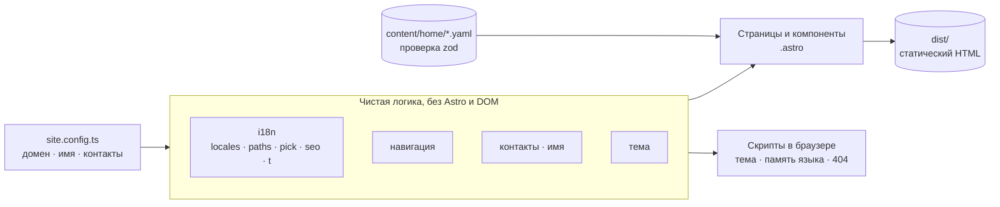

<div align="center">

# Portfolio Website

**Личный сайт Юрия Боровикова, мобильного разработчика на Flutter. Статический сайт на Astro на русском и английском, строгий TypeScript, публикация на GitHub Pages только после того, как пройдут все проверки.**

[](https://astro.build)
[](https://www.typescriptlang.org)
[](https://tailwindcss.com)
[](https://nodejs.org)
[](#тесты)
[](.github/workflows/deploy.yml)

Сайт опубликован · дизайн в работе

[English](README.md) · **Русский**

</div>

## Сайт

<a href="https://yuriyborovikov.com"></a>

## Что сейчас на сайте

Сайт опубликован, дизайн ещё в работе. Код страниц уже в репозитории: работа с языками, тема, контакты, навигация и секции главной. Страницы появятся на сайте, когда дизайн будет утверждён.

## Что уже сделано

**Два языка.** Русский и английский, по умолчанию английский. У каждого адреса есть префикс языка (`/en/`, `/ru/`). Отдельные чистые функции собирают путь, достают язык из адреса и переводят адрес на другой язык. Выбранный язык запоминается в `localStorage`. Если посетитель ещё ничего не выбирал, язык берётся из настроек браузера: для `ru*` русский, для остальных английский.

**Тексты интерфейса и контент разделены.** Короткие строки интерфейса (меню, кнопки, подписи) лежат в типизированных словарях, по одному на язык: если ключа нет в одном из них, не пройдёт проверка типов. Длинные тексты страниц лежат в YAML-файлах коллекции контента, а zod-схема проверяет их при сборке: в hero не больше трёх тегов, услуг ровно три.

**Тёмная и светлая тема.** По умолчанию тёмная. Маленький inline-скрипт в `<head>` применяет сохранённую тему до первой отрисовки, поэтому страница не мигает. Если хранилище заблокировано, сайт остаётся тёмным и работает дальше.

**Контакты и имя в одном файле.** Домен, имя на каждом языке, Telegram, GitHub и e-mail задаются один раз в `src/site.config.ts`, ссылки строятся из него. Ник с `@` и без даёт одну и ту же ссылку на `t.me`, а пустое значение просто скрывает контакт.

**SEO.** У страниц есть canonical, альтернативные ссылки `hreflang` на оба языка и `x-default`, теги Open Graph с нужной локалью. Адрес сайта в сборке берётся из домена в конфиге.

**Страница 404.** Одна статическая страница на все несуществующие адреса. Скрипт определяет язык по адресу, сохранённому выбору или браузеру и показывает нужный текст.

**robots.txt.** Собирается при сборке и закрывает от поисковиков страницу с концептом дизайна.

## Чего пока нет

- **Страниц проектов и резюме.** В навигации они уже есть, но спрятаны за флагами, которые включатся, когда страницы появятся.
- **Финального оформления.** Палитра в `global.css` рабочая, её заменят на этапе дизайна.
- **Анимаций.** Блоки для появления подготовлены в CSS (при сниженной анимации они сразу видны), но сама анимация ещё не подключена.

## Быстрый старт

Нужен Node.js **22.18+**.

```bash
npm install
npm run dev        # http://localhost:4321
```

| Команда | Что делает |
|---|---|
| `npm run dev` | Запускает сервер разработки |
| `npm run build` | Собирает статический сайт в `dist/` |
| `npm run preview` | Открывает собранный сайт локально |
| `npm run check` | Проверяет типы через `astro check` |
| `npm test` | Запускает юнит-тесты |
| `npm run test:build` | Проверяет собранный `dist/` (сначала `npm run build`) |
| `npm run verify` | Всё подряд: типы, юнит-тесты, сборка, проверки сборки |

## Архитектура



### Ключевые решения

**Логика ничего не знает про интерфейс.** Языки, пути, SEO-ссылки, контакты, навигация и тема написаны обычными функциями на TypeScript, без импортов Astro и DOM. Страницы и компоненты только собирают их вместе, а скрипты для браузера лежат в `src/scripts/`. Поэтому любую часть логики можно проверить встроенным тест-раннером Node, без браузера.

**В разметке нет захардкоженных значений.** Тексты для посетителей берутся из словарей и файлов контента, контакты и домен из конфига, языки, маршруты и цвета из именованных констант и токенов темы. Чтобы поменять контакт или добавить текст, достаточно правки в одном месте.

**Безопасная работа с хранилищем.** `localStorage` может отсутствовать или бросать ошибку (приватный режим, запрет на хранение данных). Все чтения и записи идут через две обёртки, которые вместо ошибки возвращают `null` или `false`, поэтому память языка и темы никогда не ломает страницу.

**Маленькие файлы.** Исходный файл не длиннее 200 строк; если он растёт, его делят по ответственности. Самый большой файл в `src/` далеко от этого предела.

## Публикация

Работа идёт в ветке `dev`. Пуш в `main` запускает [deploy.yml](.github/workflows/deploy.yml): он выполняет `npm run verify`, и только если всё прошло, собранный сайт уходит на GitHub Pages. Упавшая проверка типов, тест или проверка сборки останавливают публикацию.

[gitleaks.yml](.github/workflows/gitleaks.yml) проверяет всю историю на секреты при каждом пуше в `main` и `dev` и в пулл-реквестах.

## Тесты

```bash
npm run verify
```

**40 юнит-тестов** на `node:test`, по файлу на каждый модуль логики:

- пути с языком: добавить и убрать префикс, перевести адрес на другой язык;
- выбор языка: сначала сохранённый, потом язык браузера;
- ссылки `hreflang` на оба языка и `x-default`;
- ссылки на контакты: ник с `@` и без, пустые значения скрыты;
- имя на каждом языке;
- пункты меню с включёнными и выключенными страницами проектов и резюме;
- выбор темы и работа хранилища, когда оно бросает ошибку;
- словари: у обоих языков одинаковые ключи;
- понятная ошибка, если для языка нет файла с контентом главной.

**4 проверки собранного `dist/`:**

- ни в одном HTML- или XML-файле нет пустого `href`;
- главная это страница «в разработке»: без ссылки на концепт и без редиректа;
- страницы на двух языках не собираются, пока сайт в разработке;
- `404.html` и `robots.txt` на месте, robots закрывает концепт от поиска.

## Стек

| Область | Технологии |
|---|---|
| Сайт | Astro 7 (статическая сборка, i18n-маршруты, коллекции контента, `astro:assets`) |
| Язык | TypeScript, `astro/tsconfigs/strict` |
| Стили | Tailwind CSS 4 через `@tailwindcss/vite`, CSS-переменные для темы |
| Контент | YAML, схемы zod |
| Качество | `astro check`, `node:test` |
| CI и хостинг | GitHub Actions, GitHub Pages, gitleaks |

## Структура проекта

```
.
├── src/
│   ├── pages/              # главная, 404, robots.txt
│   ├── layouts/            # базовый шаблон
│   ├── components/         # head, SEO, шапка, подвал, переключатели темы и языка
│   │   └── home/           # hero, обо мне, технологии, услуги, контакты
│   ├── content/home/       # тексты страниц в en.yaml и ru.yaml
│   ├── i18n/               # языки, пути, выбор языка, hreflang, словари
│   ├── navigation/         # маршруты, якоря секций, пункты меню
│   ├── site/               # ссылки на контакты и имя
│   ├── theme/              # названия тем и выбор темы
│   ├── scripts/            # скрипты в браузере: хранилище, тема, память языка, 404
│   ├── styles/             # global.css с токенами темы
│   └── site.config.ts      # домен, имя, контакты
├── public/                 # favicon, страница концепта
├── tests/
│   ├── unit/               # тесты модулей логики
│   └── build.test.mjs      # проверки собранного сайта
└── .github/workflows/      # публикация, поиск секретов
```

## Контакты

- Telegram: [@yuriy_borovikov](https://t.me/yuriy_borovikov)
- E-mail: yuriy@yuriyborovikov.com
- Сайт: [yuriyborovikov.com](https://yuriyborovikov.com)
